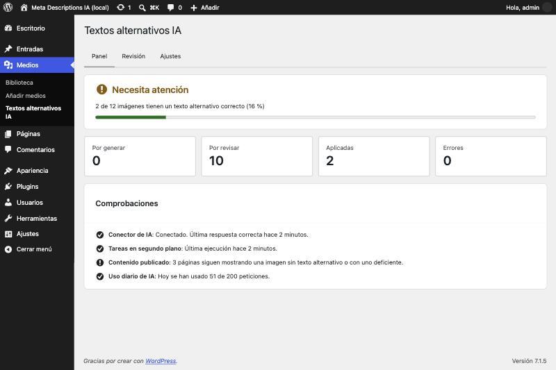
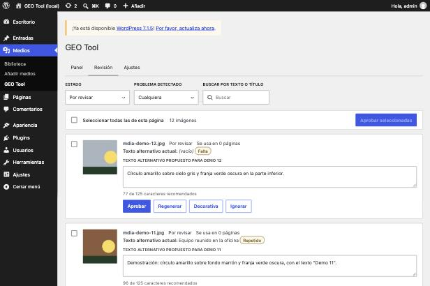
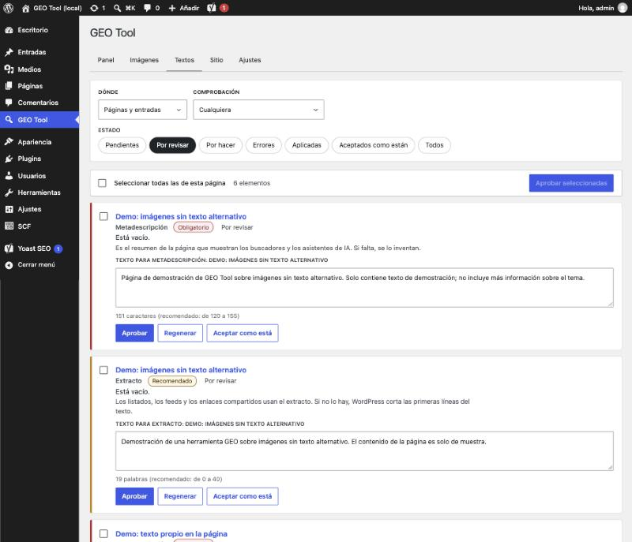

# GEO Tool by JUNGLE

Plugin de WordPress que comprueba si una web está lista para los buscadores y los asistentes de IA, propone con IA los textos que faltan y los aplica solo cuando una persona los aprueba.

Antes de entregar una web hay que confirmar muchas cosas pequeñas: que cada imagen tiene texto alternativo, que cada página tiene metadescripción, que no queda un «lorem ipsum», que el sitio no pide a los buscadores que lo ignoren. GEO Tool las revisa todas, te dice qué falta y te ayuda a rellenarlo.



## Qué hace

- **Revisa sin coste.** Analiza imágenes, páginas, entradas, categorías, autores y ajustes del sitio. Esta revisión no usa IA.
- **Propone con IA.** Escribe el texto alternativo de las imágenes y las metadescripciones, títulos, extractos y descripciones de categoría que faltan. Usa el proveedor que tengas conectado en WordPress.
- **No cambia nada por su cuenta.** Cada propuesta pasa por una persona, que la aprueba, la edita o la descarta.
- **Aplica donde hace falta.** Los textos aprobados se guardan en la biblioteca de medios, en el contenido y en los campos del plugin de SEO (Yoast SEO o Rank Math). Se puede deshacer.
- **Controla el gasto.** Tiene un límite diario de peticiones y no genera nada hasta que alguien lo lanza.
- **Informa del estado.** Un panel por áreas, un widget en el Escritorio y una prueba en Salud del sitio.

## Requisitos

- WordPress 7.0 o superior.
- PHP 8.1 o superior.
- [Yoast SEO](https://wordpress.org/plugins/wordpress-seo/) o [Rank Math](https://wordpress.org/plugins/seo-by-rank-math/), para las metadescripciones, los títulos y casi todas las comprobaciones del sitio. Sin uno de ellos, GEO Tool solo trabaja las imágenes y avisa de que falta.
- Un proveedor de IA conectado en **Ajustes > Conectores**, con su clave de API.
- WP-Cron en funcionamiento (o un cron del servidor), porque el trabajo se hace en segundo plano.

> **Clave de API o suscripción.** Los conectores oficiales (OpenAI, Anthropic y Google) piden una clave de API, que se factura por uso y es independiente de una suscripción a ChatGPT, Claude o Gemini. Describir una imagen o escribir una metadescripción suele costar una fracción de céntimo. Existe además un conector de la comunidad que usa una suscripción de ChatGPT sin clave; mira [Proveedores disponibles](#proveedores-disponibles).

## Instalación

1. Descarga el zip de la [última versión](../../releases/latest).
2. En WordPress, ve a **Plugins > Añadir nuevo > Subir plugin**, elige el zip y actívalo.
3. Se abrirá el asistente de configuración.

Si prefieres generar el zip desde el código, mira [Desarrollo](#desarrollo).

## Puesta en marcha

El asistente tiene cinco pasos:

1. **Requisitos.** Comprueba que hay un proveedor de IA conectado. Si no lo hay, te lleva a **Ajustes > Conectores**: instala el conector de tu proveedor y pega la clave de API. También avisa si no hay plugin de SEO.
2. **Prueba.** Describe una imagen de tu biblioteca para confirmar que todo funciona. No guarda nada.
3. **Preferencias.** Eliges el límite diario de peticiones, si las imágenes nuevas reciben propuesta automáticamente y si permites que la IA lea el texto de las páginas para escribir metadescripciones y otros textos.
4. **Primera revisión.** Analiza la biblioteca, el contenido y los ajustes del sitio.
5. **Listo.** Puedes lanzar la generación de propuestas o ir al panel.

Hasta que termines el asistente, el plugin no genera propuestas. Lo único que se envía antes es la imagen de la prueba del paso 2, y solo cuando pulsas el botón.

## Uso

Todo está en el menú **GEO Tool**, con cinco pestañas.

### Panel

Muestra un estado global y el de cada área: imágenes, páginas y entradas, categorías y autores, y sitio.

| Estado | Significa |
|---|---|
| **Todo en verde** | No queda nada pendiente, o alguien decidió que lo que queda no hace falta. |
| **Necesita atención** | Quedan cosas recomendadas, hay propuestas por revisar o se alcanzó el límite diario. |
| **Hay que actuar** | Falta algo obligatorio, falla el conector de IA o las tareas en segundo plano no se ejecutan. |

Debajo está la lista de **Qué falta por hacer**, con lo obligatorio primero. Cada línea lleva a los elementos afectados.

### Imágenes



Cada imagen muestra su texto actual, el problema detectado, en cuántas páginas se usa y la propuesta, que puedes editar.

| Acción | Qué hace |
|---|---|
| **Aprobar** | Aplica el texto que ves en pantalla a la biblioteca y a las páginas. |
| **Regenerar** | Pide otra propuesta a la IA. |
| **Decorativa** | Deja la imagen sin texto alternativo a propósito. Cuenta como correcta. |
| **Ignorar** | No toca nada y deja de señalar la imagen. |
| **Deshacer** | Devuelve el texto anterior a la biblioteca y a las páginas. |

Puedes seleccionar varias y usar **Aprobar seleccionadas**.

El plugin mira la página tal como se muestra, no solo el contenido guardado. Así encuentra también las imágenes que pinta el tema, por ejemplo con bloques de ACF, y distingue tres casos:

- **En el contenido.** Al aprobar, reescribe el texto en la página.
- **Sigue a la biblioteca.** El tema muestra el texto de la biblioteca de medios. Se corrige al aprobar.
- **Fijado por el tema.** El tema escribe siempre su propio texto y el plugin no puede cambiarlo. Si lo deja siempre vacío, propone marcar la imagen como decorativa, sin usar IA.

Las imágenes que no aparecen en ninguna página publicada se listan aparte, como **Sin uso**. No cuentan como pendientes y no se generan salvo que lo pidas.

Cuando el texto de la biblioteca ya es bueno y solo falta en alguna página, el plugin propone copiar ese mismo texto. En ese caso tampoco usa IA.

### Textos



Reúne lo que falta en páginas, entradas, categorías y autores. Hay dos tipos de aviso:

- **Los que se corrigen con un texto** (metadescripción, título SEO, extracto, descripción de categoría). Puedes pedir una propuesta a la IA o escribirlo tú. El contador te dice si el texto cabe en el tamaño recomendado.
- **Los que se corrigen en el editor** (imagen destacada, encabezados, texto de relleno, campos vacíos). El botón **Editar** te lleva al sitio.

Las **páginas de prueba** no se tratan como contenido por completar: se marcan para eliminar y no reciben ningún otro aviso. El botón **Enviar a la papelera** las retira de la web; se pueden recuperar desde la papelera de WordPress. Si una de ellas es contenido real, acéptala como está y se revisará como cualquier otra. Un título que también podría ser real («Testing», «Pruebas») es solo una sugerencia y no silencia los demás avisos. La portada, la página de entradas, la política de privacidad y las páginas de la tienda nunca se marcan, y si la web tiene la papelera desactivada el botón no aparece.

**Aceptar como está** descarta un aviso que no aplica. En los avisos obligatorios solo puede hacerlo un administrador, y el panel lo sigue contando como excepción.

Para que la IA proponga estos textos tienes que permitirle leer el texto de las páginas. Se activa en el asistente o en **Ajustes**.

### Sitio

Comprueba los ajustes generales. Cada aviso tiene un botón que abre el ajuste que hay que cambiar, en WordPress o en el plugin de SEO.

### Ajustes

- Límite diario de peticiones de IA (200 por defecto).
- Generación automática para imágenes nuevas.
- Permiso para que la IA lea el texto de las páginas.
- Revisar todo de nuevo y repetir el asistente.

## Webs en varios idiomas (WPML o Polylang)

Si la web usa WPML o Polylang, GEO Tool trabaja con todos los idiomas que tenga activados, sin configurar nada:

- **Revisa cada idioma.** Las páginas, categorías e imágenes de cada idioma se comprueban por separado.
- **Escribe en el idioma de cada página.** La metadescripción de una página en inglés se propone en inglés; la de su versión en catalán, en catalán.
- **No confunde traducciones con duplicados.** Dos páginas en idiomas distintos pueden compartir título o descripción sin que salte el aviso, y las copias de una imagen en otros idiomas no cuentan como texto alternativo repetido.
- **Muestra y filtra por idioma.** Cada aviso lleva la etiqueta de su idioma y la pestaña Textos tiene un filtro.
- **Imágenes.** Una página traducida conserva la imagen de la página original, pero necesita el texto alternativo en su idioma. Si la imagen tiene copia en ese idioma (WPML Media Translation, o los medios traducibles de Polylang), el texto de esa copia es el que se propone y se escribe en esa página. Si no la tiene, esa página se deja como está: nunca se escribe un texto en español en una página en inglés.
- **Imágenes que solo aparecen en páginas de otro idioma.** No se envían a la IA: su texto no llegaría a ninguna página. Se listan como sin uso.
- **El idioma del escritorio no influye.** Da igual en qué idioma tenga WordPress quien revisa: cada cosa se comprueba en el suyo, y el sitio, en el idioma principal.

## Qué comprueba

| Área | Comprobación | Tipo |
|---|---|---|
| Imágenes | Texto alternativo en la biblioteca y en cada página | Obligatoria |
| Páginas y entradas | Metadescripción: existe, mide entre 120 y 155 caracteres, no repite el título ni la de otra página | Obligatoria |
| Páginas y entradas | Página de prueba para eliminar: el contenido de ejemplo de WordPress («Hello world!», «Sample Page») o una página titulada «Página de prueba», «Test 2»… | Obligatoria |
| Páginas y entradas | Restos de plantilla: «lorem ipsum» o cifras sin rellenar («+xxx») | Obligatoria |
| Páginas y entradas | Título en buscadores: no pasa de 60 caracteres ni se repite | Recomendada |
| Páginas y entradas | Extracto en las entradas | Recomendada |
| Páginas y entradas | Encabezados: un solo H1 y sin saltos de nivel | Recomendada |
| Páginas y entradas | Campos de ACF vacíos | Obligatoria si el campo es obligatorio; si no, recomendada |
| Páginas y entradas | Imagen destacada | Recomendada |
| Páginas y entradas | Página publicada que pide no ser indexada | Recomendada |
| Categorías y etiquetas | Descripción | Recomendada |
| Autores | Biografía y nombre público | Recomendada |
| Sitio | Plugin de SEO activo (Yoast SEO o Rank Math) | Obligatoria |
| Sitio | El sitio no pide a los buscadores que lo ignoren | Obligatoria |
| Sitio | Título y descripción corta del sitio | Obligatoria |
| Sitio | Metadescripción de la portada | Obligatoria |
| Sitio | Nombre y logotipo de la organización en los datos estructurados | Obligatoria |
| Sitio | Mapa del sitio XML | Obligatoria |
| Sitio | robots.txt no bloquea el sitio ni a los rastreadores de IA | Obligatoria |
| Sitio | Datos estructurados | Obligatoria |
| Sitio | HTTPS y enlaces permanentes legibles | Obligatoria |
| Sitio | llms.txt, imagen por defecto al compartir, icono del sitio | Recomendada |
| Sitio | Nombre del sitio demasiado largo para los títulos | Recomendada |

En un entorno local o de desarrollo no se juzgan HTTPS ni la visibilidad para buscadores, porque solo importan en producción.

## Proveedores disponibles

GEO Tool funciona con cualquier proveedor que tenga un conector para el cliente de IA de WordPress, siempre que ofrezca un modelo que admita imágenes. Situación a noviembre de 2026:

| Proveedor | Conector | Mantiene | Acceso |
|---|---|---|---|
| Anthropic (Claude) | [ai-provider-for-anthropic](https://wordpress.org/plugins/ai-provider-for-anthropic/) | WordPress.org | Clave de API |
| OpenAI (GPT) | [ai-provider-for-openai](https://wordpress.org/plugins/ai-provider-for-openai/) | WordPress.org | Clave de API |
| Google (Gemini) | [ai-provider-for-google](https://wordpress.org/plugins/ai-provider-for-google/) | WordPress.org | Clave de API |
| ChatGPT con suscripción | [ai-provider-for-chatgpt](https://wordpress.org/plugins/ai-provider-for-chatgpt/) | Comunidad | Inicio de sesión con un plan Plus, Pro o Go; sin clave |
| Microsoft Azure AI Foundry | [ai-provider-for-azure-ai-foundry](https://wordpress.org/plugins/ai-provider-for-azure-ai-foundry/) | Comunidad | Clave y punto de acceso de Azure |
| Amazon Bedrock | [ai-provider-for-bedrock](https://github.com/achttienvijftien/ai-provider-for-bedrock) (GitHub) | Comunidad | Clave de API de Bedrock |
| Mistral | [ai-provider-for-mistral](https://wordpress.org/plugins/ai-provider-for-mistral/) | Comunidad | Clave de API |
| OpenRouter | [ai-provider-for-openrouter](https://wordpress.org/plugins/ai-provider-for-openrouter/) | Comunidad | Clave de API |
| Vercel AI Gateway | [vercel-ai-gateway-provider](https://wordpress.org/plugins/vercel-ai-gateway-provider/) | Vercel | Clave de API |
| Ollama (modelos locales) | [ai-provider-for-ollama](https://wordpress.org/plugins/ai-provider-for-ollama/) | Comunidad | Sin clave; servidor propio |

- **Probado aquí:** Anthropic con Claude Haiku 5.5, a través de Amazon Bedrock. El resto no se ha probado con este plugin.
- **Copilot:** no hay conector para Microsoft Copilot ni para GitHub Copilot. La vía de Microsoft es Azure AI Foundry.
- **Otros:** también hay conectores de la comunidad para DeepSeek, xAI (Grok) y Groq. Comprueba antes que el modelo admite imágenes.
- Los conectores de la comunidad no forman parte de GEO Tool ni tienen soporte aquí. Revisa quién los mantiene antes de instalarlos en la web de un cliente.

## Qué considera un texto alternativo deficiente

| Problema | Regla |
|---|---|
| Falta | Está vacío. |
| Nombre de archivo | Es el nombre del archivo o lo parece (`IMG_2034`, `captura-de-pantalla-2026`). |
| Genérico | Es una palabra como «imagen», «foto», «logo» o «sin título». |
| Demasiado corto | Menos de 5 caracteres. |
| Demasiado largo | Más de 150 caracteres. |
| Repetido | El mismo texto en 5 o más imágenes. |

## Qué cambia en tu web y qué no

Al aprobar un texto, el plugin:

- Actualiza el texto alternativo de la imagen en la biblioteca de medios.
- Actualiza el atributo `alt` en las entradas, páginas, patrones sincronizados y plantillas donde aparece esa imagen. En los bloques que guardan ese texto también en sus atributos (como Fondo), actualiza los dos sitios. Cada página guarda una revisión de WordPress.
- Solo llega al contenido que podría editar quien aprueba: un editor no modifica plantillas; un administrador sí.

En una página solo sustituye el texto si está vacío, si es una copia del texto antiguo de la biblioteca o si incumple las reglas. **Un texto bueno escrito para esa página se respeta.**

No toca el título, la leyenda ni la descripción de la imagen.

Los textos de páginas y categorías se guardan en el campo que corresponde: la metadescripción y el título, en Yoast SEO o Rank Math; el extracto y la descripción de categoría, en WordPress. Cada cambio se puede deshacer desde la misma lista.

## Privacidad y costes

- Para describir una imagen se envía al proveedor de IA que hayas conectado una copia reducida (1024 px de lado mayor como máximo), el nombre del archivo, su título, su texto alternativo actual y el título de una página donde se usa. No se envía nada a nadie más.
- Para proponer una metadescripción, un título, un extracto o una descripción de categoría se envía el título y hasta 3000 caracteres del texto visible de esa página. Solo ocurre si lo has permitido en los ajustes, y solo con páginas publicadas.
- El plugin nunca guarda ni muestra tu clave de API. La gestiona WordPress en **Ajustes > Conectores**.
- Las imágenes se vuelven a codificar antes de enviarse, sin sus metadatos (por ejemplo, la posición GPS de la cámara).
- Las propuestas nunca contienen enlaces ni direcciones de correo, aunque aparezcan en la imagen.
- Solo generan propuesta automática las imágenes que sube alguien con permiso para revisar.
- El límite diario cuenta todas las peticiones, incluidos los reintentos. Al alcanzarlo, el plugin se detiene y continúa al día siguiente.
- Tres errores seguidos del proveedor detienen la cola, para que una clave caducada no consuma el límite.

## Límites conocidos

- **Yoast SEO o Rank Math.** Las metadescripciones y los títulos se leen y se escriben en uno de los dos. Si están activos a la vez, se usa Yoast SEO. Otros plugins de SEO se pueden añadir con el filtro `mdia_seo_adapter`.
- **Rank Math y las descripciones automáticas.** Cuando nadie escribe una descripción, Rank Math publica las primeras líneas del contenido. GEO Tool no lo da por bueno: pide una descripción escrita.
- **Rank Math recién instalado.** Hasta que se completa o se salta su asistente inicial, Rank Math no publica nada y GEO Tool lo trata como inactivo.
- **Constructores visuales.** Las imágenes colocadas con Elementor se actualizan en la biblioteca, pero no dentro de esas páginas. El panel indica cuántas hay.
- **Lo que pinta la plantilla de la página.** El plugin compone el contenido y sus bloques, no la cabecera ni el pie del tema. Una imagen que solo aparezca ahí figura como sin uso.
- **Encabezados.** No se puede saber desde el plugin si el tema ya pone el título como H1, así que un único H1 en el contenido se da por bueno.
- **Formatos.** Se revisan JPEG, PNG, WebP y GIF. No se revisan SVG ni archivos que no sean imágenes.
- **Webs multilingües: WPML o Polylang.** Con ellos, cada texto se escribe en el idioma de su página. Otros plugins de idiomas (TranslatePress, Weglot…) no están soportados: en ellos todo se escribe en el idioma del sitio.
- **Ajustes del sitio en un idioma.** La metadescripción de la portada, la organización y el resto de ajustes del sitio se comprueban una vez, en el idioma principal. La biografía de los autores también se comprueba solo en el idioma principal.
- **Multisitio.** Funciona sitio a sitio, sin administración de red.

## Preguntas frecuentes

**¿Puedo elegir el modelo de IA?**
Sí, con el filtro `mdia_model_preference`. Los modelos pequeños (Claude Haiku, GPT mini, Gemini Flash) dan buen resultado y cuestan menos.

```php
add_filter( 'mdia_model_preference', fn() => array( 'claude-haiku-5-5' ) );
```

**¿Qué proveedores puedo usar?**
Cualquiera que tenga un conector para el cliente de IA de WordPress y ofrezca un modelo que admita imágenes. Mira [Proveedores disponibles](#proveedores-disponibles).

**Las tareas en segundo plano aparecen en rojo.**
El plugin depende de WP-Cron. Comprueba que funciona en tu web o configura un cron del servidor.

**¿Cómo se actualiza?**
Cuando se publica una versión nueva en este repositorio, aparece en **Plugins** como cualquier otra actualización. El plugin consulta las versiones publicadas en GitHub; no envía ningún dato de tu web.

**¿Puedo usarlo solo para la entrega y quitarlo después?**
Sí. Los textos aprobados quedan en WordPress y en el plugin de SEO; no dependen de GEO Tool.

**¿Qué pasa al desinstalarlo?**
Se borran sus tablas y ajustes. Los textos ya aplicados se conservan.

## Para desarrolladores

### Filtros

| Filtro | Para qué sirve |
|---|---|
| `mdia_model_preference` | Modelos preferidos, por orden. |
| `mdia_system_prompt` | Instrucciones que recibe la IA para describir imágenes. |
| `mdia_text_system_prompt` | Instrucciones que recibe la IA para escribir metadescripciones y otros textos. |
| `mdia_max_tokens` | Límite de tokens de salida por petición (2000 por defecto). |
| `mdia_checks` | Lista de comprobaciones: permite quitar alguna o añadir las tuyas. |
| `mdia_seo_adapter` | Sustituye el adaptador del plugin de SEO. |
| `mdia_ai_agents` | Rastreadores de IA que robots.txt no debe bloquear. |
| `mdia_audit_config` | Umbrales y palabras genéricas de la revisión. |
| `mdia_indexed_post_types` | Tipos de contenido que se revisan y reescriben. |
| `mdia_unmanaged_attachment_ids` | Imágenes que una página usa en un sitio que el plugin no puede reescribir. |
| `mdia_max_source_bytes` / `mdia_max_source_pixels` | Tamaño máximo de imagen que se analiza. |
| `mdia_provider` | Sustituye el proveedor de IA (se usa en las pruebas). |

### Permisos

- `mdia_manage`: ajustes, asistente y lanzar la generación. Lo tienen los administradores.
- `mdia_review`: revisar y aprobar. Lo tienen administradores y editores.

Además, cada acción exige poder editar el elemento afectado. Aceptar como está un aviso obligatorio pide `mdia_manage`.

Si los roles del sitio se restablecen, el plugin vuelve a conceder estos permisos.

### Desarrollo

Solo hace falta Docker. PHP, Composer, Node, WP-CLI y las pruebas corren en contenedores.

```bash
cp .env.example .env
```

Cambia las contraseñas de `.env` y ejecuta, en este orden:

```bash
bin/composer install
```

```bash
bin/npm install
```

```bash
bin/npm run build
```

```bash
bin/setup
```

`bin/setup` arranca los contenedores, instala WordPress en español con los datos de `.env`, instala los conectores oficiales de IA y activa el plugin.

La web queda en http://localhost:8787 y el correo de prueba en http://localhost:8797.

| Comando | Qué hace |
|---|---|
| `bin/setup` | Arranca el entorno e instala WordPress y el plugin. |
| `bin/test-all` | Pruebas unitarias y de integración. |
| `bin/test unit` · `bin/test integration` | Cada suite por separado. |
| `bin/npm run build` | Compila la interfaz en `plugin/build/`. |
| `bin/wp …` | WP-CLI. |
| `bin/seed [proposals]` | Crea imágenes y entradas de demostración. |
| `bin/i18n` | Regenera los archivos de idioma. |
| `bin/build-zip` | Genera `dist/geo-tool-{versión}.zip`. |
| `bin/check-zip` | Instala ese zip en un WordPress limpio y desechable. |

El servicio `cron` de `docker-compose.yml` ejecuta las tareas en segundo plano cada 20 segundos.

### Estructura

```
plugin/                 el plugin
  src/                  código PHP, espacio de nombres MDIA\
  assets/src/           interfaz de administración (React)
  languages/            traducciones (es_ES incluida)
  tests/                pruebas y datos de demostración
bin/                    envoltorios de Docker
docker/                 archivos solo del entorno local
docs/                   imágenes del README
```

Las cadenas del código están en inglés. Tras añadir o cambiar cadenas, ejecuta `bin/i18n`, traduce las nuevas en `plugin/languages/geo-tool-es_ES.po` y vuelve a ejecutarlo.

## Seguridad

Si encuentras un problema de seguridad, no abras una incidencia pública. Mira [SECURITY.md](SECURITY.md).

## Licencia

[GPL-2.0-or-later](LICENSE). Hecho por [Prodigioso Volcán](https://www.prodigiosovolcan.com).
